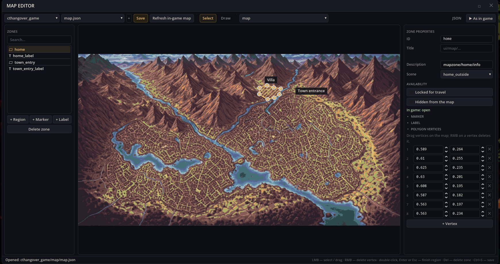

# ワールドマップエディター — ワールドマップのゾーン、マーカー、ラベル

ワールドマップエディターは、実行中のゲームの上で `map_base` の旅のマップを描きます。領域の多角形、マーカー、ラベルにはそれぞれタイトル、説明、行き先のシーン、移動不可や非表示の設定があります。プレビューはプレイヤーが見るとおりにマップを表示し、**ゲーム内のマップを更新**で保存した変更を実行中のゲームに反映します。

このツールはワールドマップ用です。RPG ワールドのタイルマップは RPG マップエディター（`rpg_editor`）で編集します。

## 開き方

ゲームのツールバーのハンマーボタン → **マップエディター**。

## マップの編集

1. セレクターで MOD とマップファイル（`map/*.json`）を選びます。
2. **+ 領域**（または**描画**）でマップをクリックして頂点を置きます。ダブルクリック、Enter、Esc で終了し、右クリックで最後の頂点を消します。**+ マーカー**と **+ ラベル**でほかの種類のゾーンを加えます。
3. **ゾーン**の一覧かマップでゾーンを選びます。**ゾーンのプロパティ**で ID、**タイトル**と**説明**（ローカライズキー。翻訳がなければ印が付きます）、**シーン**、**利用可否**（*移動不可*、*マップに表示しない*）を設定します。**ゲーム内：**の行は、プレイヤーが実際に得るもの（開放、フラグでロック、シーンがないためロック、非表示）を示します。
4. マップ上でゾーンや頂点をドラッグします。頂点を右クリックで削除、Del でゾーンを削除します。
5. **▶ ゲームと同じ表示**は、未保存の変更も含め、プレイヤーが見るとおりのマップ（ホバー、ゾーンカード、マーカー）を表示します。
6. Ctrl+S で保存し、**ゲーム内のマップを更新**で実行中のゲームが保存済みファイルを読み直します。

## 制限

- フォルダー MOD のみ。パックされた MOD は読み取り専用です。
- タイトルと説明はローカライズキーで、そのテキストは MOD のローカライズファイルで編集します。

## 依存関係

`tools_base`、`map_base`、`ui_base`。
古い `editor_tools` パッケージは、この MOD をほかの作成用ウィンドウと一緒にインストールします。
