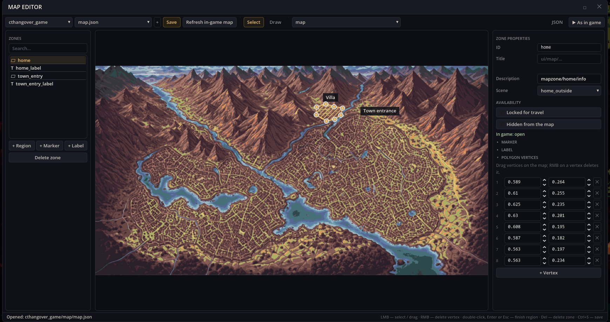

# 월드맵 에디터 — 월드맵의 구역, 표식, 라벨

월드맵 에디터는 실행 중인 게임 위에서 `map_base`의 여행 지도를 그립니다. 영역 다각형, 표식, 라벨에는 각각 제목, 설명, 이어지는 장면, 이동 불가나 숨김 여부가 있습니다. 미리보기는 플레이어가 보는 그대로 지도를 보여 주고, **게임 내 지도 새로 고침**은 저장한 변경을 실행 중인 게임에 반영합니다.

이 도구는 월드맵용입니다. RPG 세계의 타일 맵은 RPG 맵 에디터(`rpg_editor`)로 편집합니다.

## 여는 방법

게임 툴바의 망치 버튼 → **맵 에디터**.

## 지도 편집

1. 선택기에서 모드와 지도 파일(`map/*.json`)을 고릅니다.
2. **+ 영역**(또는 **그리기**)을 누르고 지도를 클릭해 꼭짓점을 놓습니다. 더블클릭, Enter, Esc로 끝내고 오른쪽 클릭으로 마지막 꼭짓점을 지웁니다. **+ 표식**과 **+ 라벨**은 다른 종류의 구역을 추가합니다.
3. **구역** 목록이나 지도에서 구역을 고릅니다. **구역 속성**에서 ID, **제목**과 **설명**(현지화 키, 번역이 없으면 표시됨), **장면**, **이용 여부**(*이동 불가*, *지도에서 숨김*)를 정합니다. **게임에서:** 줄은 플레이어가 실제로 받게 될 상태(열림, 플래그로 잠김, 장면이 없어 잠김, 숨김)를 알려 줍니다.
4. 지도에서 구역과 꼭짓점을 끕니다. 꼭짓점을 오른쪽 클릭하면 삭제되고 Del은 구역을 삭제합니다.
5. **▶ 게임처럼 보기**는 저장하지 않은 편집까지 포함해 플레이어가 보는 지도(호버, 구역 카드, 표식)를 보여 줍니다.
6. Ctrl+S로 저장하고, **게임 내 지도 새로 고침**으로 실행 중인 게임이 저장된 파일을 다시 읽습니다.

## 제한

- 폴더 모드만 가능하며, 패키지된 모드는 읽기 전용입니다.
- 제목과 설명은 현지화 키이며, 텍스트는 모드의 현지화 파일에서 편집합니다.

## 의존성

`tools_base`, `map_base`, `ui_base`.
예전 `editor_tools` 패키지는 이 모드를 다른 제작 창과 함께 설치합니다.
