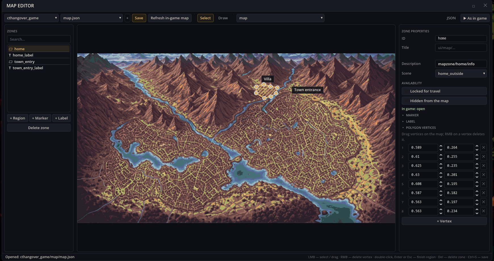

# Редактор карты мира — зоны, метки и надписи карты мира

Редактор карты мира рисует карту путешествий `map_base` поверх запущенной игры: многоугольники регионов, метки и надписи, у каждой — название, описание, сцена, в которую она ведёт, и признаки «закрыта» или «скрыта». Предпросмотр показывает карту ровно так, как её увидит игрок, а **Обновить карту в игре** переносит сохранённые изменения в запущенную игру.

Этот инструмент — для карты мира. Тайловые карты RPG-мира правит редактор RPG-карт (`rpg_editor`).

## Как открыть

Кнопка с молотком на игровом тулбаре → **Редактор карты**.

## Правка карты

1. Выберите мод и файл карты (`map/*.json`) в селекторе.
2. **+ Регион** (или **Рисование**) и щелчки по карте ставят вершины; двойной щелчок, Enter или Esc завершают, ПКМ убирает последнюю вершину. **+ Метка** и **+ Надпись** добавляют зоны других видов.
3. Выберите зону в списке **Зоны** или на карте. В **Свойствах зоны** задайте ID, **Название** и **Описание** (ключи локализации; отсутствующий перевод помечается), **Сцену** и **Доступность**: *Закрыта для посещения* или *Скрыта с карты*. Строка **В игре:** говорит, что на самом деле получит игрок (открыта, закрыта флагом, закрыта, потому что сцены нет, скрыта).
4. Перетаскивайте зоны и вершины по карте; ПКМ по вершине удаляет её, Del удаляет зону.
5. **▶ Как в игре** показывает карту так, как её видит игрок (наведение, карточка зоны, метки), включая несохранённые правки.
6. Ctrl+S сохраняет; **Обновить карту в игре** перечитывает сохранённые файлы в запущенной игре.

## Ограничения

- Только моды-папки; упакованные моды только для чтения.
- Названия и описания — ключи локализации; их тексты правятся в файлах локализации мода.

## Зависимости

`tools_base`, `map_base`, `ui_base`.
Старый пакет `editor_tools` ставит этот мод вместе с остальными авторскими окнами.
