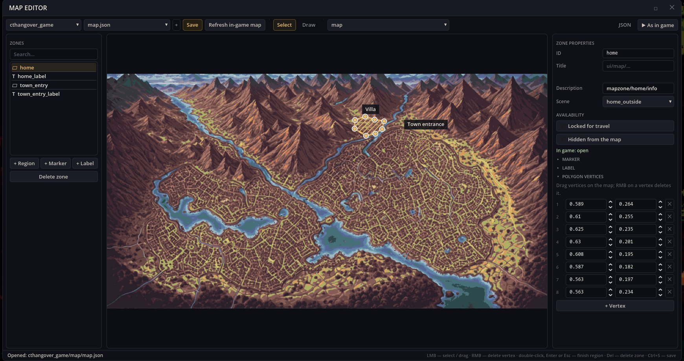

# Trình sửa bản đồ thế giới — vùng, điểm đánh dấu và nhãn của bản đồ thế giới

Trình sửa bản đồ thế giới vẽ bản đồ du hành của `map_base` ngay trên trò chơi đang chạy: đa giác khu vực, điểm đánh dấu và nhãn, mỗi cái có tiêu đề, mô tả, cảnh mà nó dẫn tới và việc nó bị khóa hay ẩn. Bản xem trước hiện bản đồ đúng như người chơi sẽ thấy, và **Làm mới bản đồ trong game** đưa các thay đổi đã lưu vào trò chơi đang chạy.

Công cụ này dành cho bản đồ thế giới. Bản đồ ô của thế giới RPG được sửa bằng trình sửa bản đồ RPG (`rpg_editor`).

## Cách mở

Nút búa trên thanh công cụ trong trò chơi → **Trình sửa bản đồ**.

## Sửa bản đồ

1. Chọn mod và tệp bản đồ (`map/*.json`) trong bộ chọn.
2. **+ Khu vực** (hoặc **Vẽ**) rồi bấm lên bản đồ để đặt đỉnh; nhấp đúp, Enter hoặc Esc để kết thúc, chuột phải bỏ đỉnh cuối. **+ Điểm đánh dấu** và **+ Nhãn** thêm các loại vùng khác.
3. Chọn một vùng trong **Vùng** hoặc trên bản đồ. Trong **Thuộc tính vùng** đặt ID, **Tiêu đề** và **Mô tả** (khóa bản địa hóa; bản dịch thiếu sẽ được đánh dấu), **Cảnh** và **Khả dụng**: *Không cho di chuyển tới* hoặc *Ẩn khỏi bản đồ*. Dòng **Trong game:** cho biết người chơi thực sự nhận được gì (mở, bị khóa bởi cờ, bị khóa vì không có cảnh, bị ẩn).
4. Kéo vùng và đỉnh trên bản đồ; chuột phải vào một đỉnh để xóa nó, Del xóa vùng.
5. **▶ Như trong game** hiện bản đồ như người chơi thấy (rê chuột, thẻ vùng, điểm đánh dấu), kể cả thay đổi chưa lưu.
6. Ctrl+S lưu; **Làm mới bản đồ trong game** đọc lại các tệp đã lưu trong trò chơi đang chạy.

## Giới hạn

- Chỉ mod dạng thư mục; mod đóng gói chỉ đọc.
- Tiêu đề và mô tả là khóa bản địa hóa; văn bản của chúng được sửa trong tệp bản địa hóa của mod.

## Phụ thuộc

`tools_base`, `map_base`, `ui_base`.
Gói cũ `editor_tools` cài mod này cùng các cửa sổ tác giả khác.
