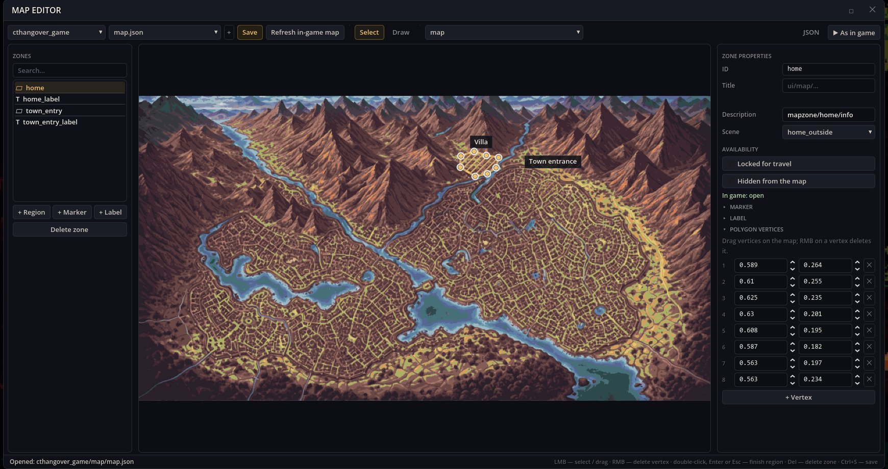

# 世界地图编辑器 —— 世界地图的区域、标记和文字标签

世界地图编辑器在运行中的游戏上绘制 `map_base` 的旅行地图：区域多边形、标记和文字标签，每个都有标题、描述、通往的场景，以及是否锁定或隐藏。预览按玩家所见显示地图，**刷新游戏内地图**会把已保存的修改带入运行中的游戏。

这个工具用于世界地图。RPG 世界的图块地图由 RPG 地图编辑器（`rpg_editor`）编辑。

## 打开方式

游戏工具栏上的锤子按钮 → **地图编辑器**。

## 编辑地图

1. 在选择器中选择模组和地图文件（`map/*.json`）。
2. **+ 区域**（或**绘制**），点击地图放置顶点；双击、Enter 或 Esc 结束，右键移除最后一个顶点。**+ 标记**和 **+ 文字标签**添加其他类型的区域。
3. 在**区域**列表或地图上选择区域。在**区域属性**中设置 ID、**标题**和**描述**（本地化键；缺少翻译会被标出）、**场景**以及**可用性**：*禁止前往*或*在地图上隐藏*。**游戏中：**一行说明玩家实际会得到什么（开放、被标志锁定、因场景不存在而锁定、隐藏）。
4. 在地图上拖动区域和顶点；右键点击顶点删除它，Del 删除区域。
5. **▶ 游戏中效果**按玩家所见显示地图（悬停、区域卡片、标记），包括未保存的修改。
6. Ctrl+S 保存；**刷新游戏内地图**会在运行中的游戏里重新读取已保存的文件。

## 限制

- 仅限文件夹模组；打包的模组是只读的。
- 标题和描述是本地化键，其文本在模组的本地化文件中编辑。

## 依赖

`tools_base`、`map_base`、`ui_base`。
旧的 `editor_tools` 包会把这个模组和其他创作窗口一起安装。
